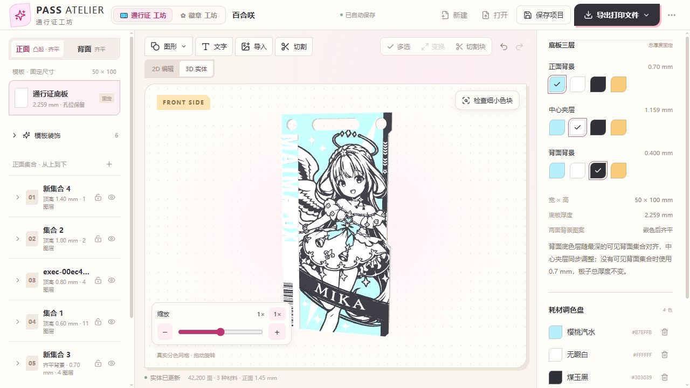
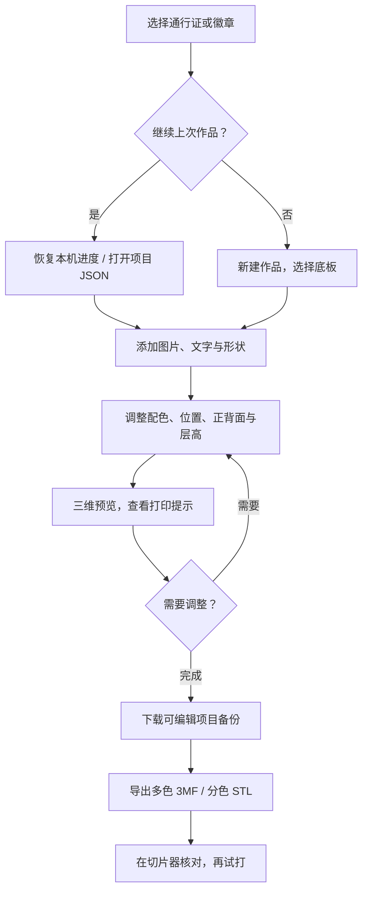
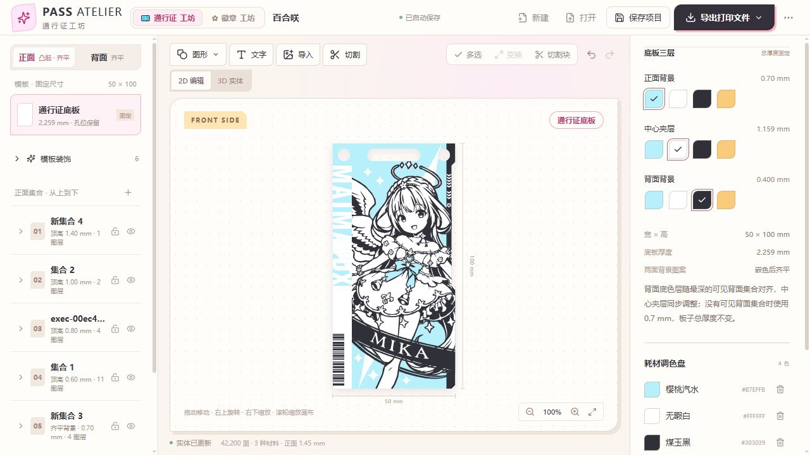
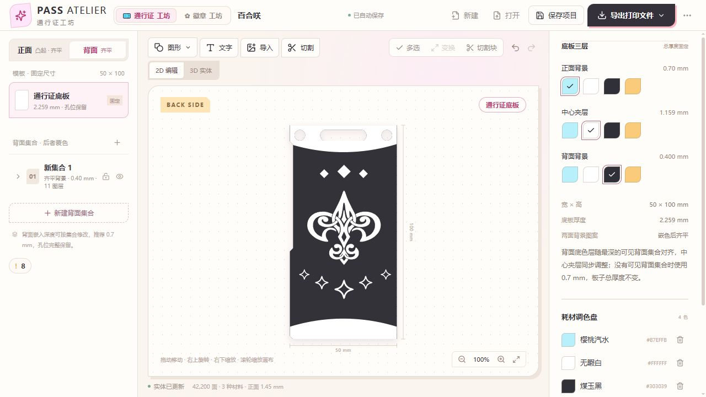
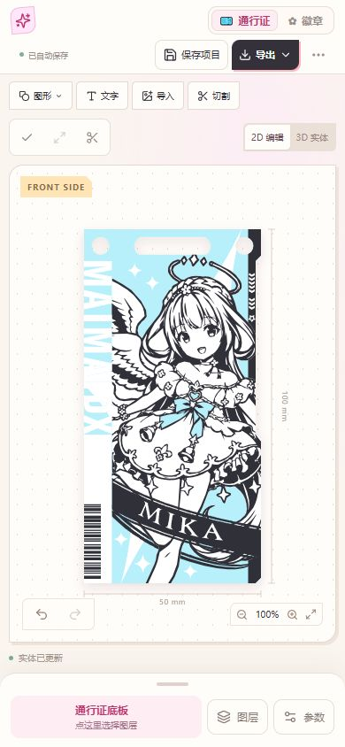

# 通行证工坊 · PASS ATELIER

[](https://github.com/lilisanae/sanae-pass-atelier/actions/workflows/ci.yml)
[](LICENSE)
[](https://github.com/lilisanae/sanae-pass-atelier/releases)



**通行证工坊**是一个在浏览器里制作多色 3D 打印通行证和徽章的小工具。放入图案、写上文字、调整正背面和层高，核对三维效果后，就能下载模型，交给切片器继续打印。

不用先学会建模，也不用注册账号。图像处理、实体生成和作品保存主要在你的设备上完成。

**[打开通行证工坊](https://beatsanae.cn/pass/)** · **[打开徽章工坊](https://beatsanae.cn/badge/)** · **[下载发行包](https://github.com/lilisanae/sanae-pass-atelier/releases)** · **[使用说明](docs/guide.md)**

> 把喜欢，做成能带走的形状。

## 可以做些什么

| 自由排版                            | 做成真实实体                     | 保存与打印                  |
| ----------------------------------- | -------------------------------- | --------------------------- |
| 图片、静态 SVG、文字、34 款内置形状 | 正背面设计、齐平嵌色与凸起层     | 自动保存本机进度            |
| 图层、集合、文件夹与多选            | 剪影、填充、内外描边             | 下载可继续编辑的项目文件    |
| 移动、旋转、镜像、整体缩放与吸附    | 指定目标裁切、反向裁切、图层合并 | 多色 3MF 与按颜色拆分的 STL |
| 字体导入、字距、行距与多行对齐      | 三维预览、细小色块检查           | 桌面 / 手机、深浅主题       |

通行证使用固定底板和孔位；徽章可以调整外轮廓、三层厚度与背面安装槽。两个工坊使用同一套编辑方式，各自保存进度。

## 从想法到打印



三维预览使用实际生成的网格；生成未完成、模型过期或存在错误时会阻止导出。提示可以辅助发现问题，不能替代切片和试打。

## 发行案例：百合咲

这次用一份完整作品展示工坊的操作：50 × 100 mm 通行证，四种配色、六个集合，包含正反面图案、分色路径、剪影、文字和裁切设置。所有截图都来自工坊实际打开这份项目后的画面。

**[下载案例项目](https://github.com/lilisanae/sanae-pass-atelier/releases/download/v0.7.1/yurisaki.pass.json)** · **[查看案例说明](examples/README.md)** · [仓库中的原始项目](examples/yurisaki.pass.json)

下载后在工坊点「打开」，选择 `yurisaki.pass.json` 即可继续编辑。静态发行包和源码包也都附带 `examples/` 目录；案例作为独立可编辑文件提供，不会覆盖浏览器里已有作品。

### 正面：图案、剪影与叠层



正面以浅蓝、白、黑分色，在集合中组织人物图案、剪影和背景。左侧选择集合，右侧查看当前对象的尺寸、颜色和参数；切换三维后可以核对真实厚度。

### 背面：独立排版与齐平嵌色



背面有独立集合，图案按本案例的 0.40 mm 深度嵌入底板。正背面颜色可以分别设置，板子总厚度保持项目原有值。

### 三维：查看实际生成的模型

文章开头的三维图和二维编辑使用同一份项目。当前模型约 42,200 个三角面，实际使用浅蓝、白、黑三种材料；调色盘里保留了第四种备用色。

案例保留原设计与打印提示，包括未绑定目标的切割工具和小于 0.2 mm 的轮廓细节。它用于演示与继续编辑，未宣称完成本次切片或实物试打；详见[案例说明](examples/README.md#打印前核对)。

### 手机上也能继续做



手机保留同一份图案与编辑方式，图层和参数从底部面板打开。上图为 390 px 浏览器手机视图截图，不是实机照片。

## 快速开始

1. 打开[通行证工坊](https://beatsanae.cn/pass/)或[徽章工坊](https://beatsanae.cn/badge/)，等待工作台准备好。
2. 从案例开始，或点「新建」；添加图形、文字，或导入 PNG / JPG / WebP / 静态 SVG。
3. 调整位置、颜色与所属集合。集合控制物理层高，文件夹用于整理图层。
4. 切到「3D 实体」，查看两面、细节和打印提示，需要时检查细小色块。
5. 先点「保存项目」下载备份，再导出 3MF，交给切片器核对材料和参数。

通行证项目下载为 `.pass.json`，徽章为 `.badge.json`。下次用「打开」继续编辑。

## 作品放在哪里

- **本机进度**保存在当前浏览器的 IndexedDB 中，通行证和徽章分开；编辑后会自动合并保存。
- **项目文件**是你下载的可编辑备份，包含图案路径、文字、字体和配色；建议定期留一份。
- **程序缓存**保存下载过的公开程序、字库和模板，减少重复加载，和作品进度是两回事。

清理浏览器、更换设备或网站来源后，本机进度不会自动跟过去。内存中的撤销历史也不会写入项目文件；请用项目备份迁移作品。

作品内容不会上传到云端建模服务。官方站点在下载模型后会发送只含文件种类的匿名导出事件；独立部署在其他主机时默认不发送。详见[数据与存储说明](docs/guide.md#数据与隐私)。

## 打印前看一下

- 优先使用 **3MF** 保留颜色和装配关系；STL ZIP 中的部件共用坐标，请作为一个多部件模型载入。
- 3MF 附作者 **Bambu A1 / 0.2 mm 喷嘴**预设。其他机器、喷嘴或耗材，请在切片器切换并核对参数。
- 细线、薄壁、悬空、小色块与材料切换，仍需结合层高、切片结果和试打判断。
- 本工具不提供在线切片、远程打印或打印成功保证。

## 从源码运行

环境使用仓库 `.node-version` 指定的 Node.js 24，以及 `package.json` 指定的 pnpm 11.25.0。版本锁定和依赖锁文件随源码提供。

```sh
git clone https://github.com/lilisanae/sanae-pass-atelier.git
cd sanae-pass-atelier
pnpm install --frozen-lockfile
pnpm dev
```

开发地址默认是 `http://127.0.0.1:5173/`。独立部署中，`/` 打开通行证，`/?workshop=badge` 打开徽章。

```sh
pnpm build      # 类型检查与静态构建
pnpm test       # 项目、几何、导入、导出与缓存测试
pnpm preview    # 预览构建结果
pnpm package    # 生成静态包与源码包
```

将**完整 `dist/`** 部署到支持 HTTPS 的静态托管，包括 `assets/` 和 `workshop-cache-worker.js`。核心编辑器不需要服务器数据库或账号系统；不要直接双击应用的 index.html 用 file:// 运行，Worker / WASM 需要 HTTP(S) 环境。

## 常见问题

<details><summary><strong>我不会建模，也能用吗？</strong></summary>

可以先从内置案例或普通通行证开始。先完成二维排版，再核对三维；打印部分仍需要会使用自己的切片器。

</details>

<details><summary><strong>改颜色为什么没有降低高度？</strong></summary>

颜色和层高是独立设置。颜色由图案/材料决定，凸起高度由所属集合的厚度累计；要改高度，请调整集合。

</details>

<details><summary><strong>为什么第一次打开仍要等字库？</strong></summary>

首次需要下载程序和所用字库。后续会复用本机缓存；浏览器清理、缓存不可用或所需资源更新时，仍可能重新下载。这不是完整离线应用。

</details>

<details><summary><strong>可以把自己的图案用在成品上吗？</strong></summary>

可以导入本地图案。请自行确认图像、字体、商标或角色形象的使用范围；本项目的软件许可不会替你授予第三方素材权利。

</details>

## 反馈与参与

欢迎在 [Issues](https://github.com/lilisanae/sanae-pass-atelier/issues) 提交问题或建议。说明浏览器、手机/电脑、复现步骤，以及期望和实际结果；需要提供项目文件时，请先移除私人内容。

贡献代码前可看 [CONTRIBUTING.md](CONTRIBUTING.md)。请保留旧项目兼容性；涉及几何、保存或导出时，附上相应检查结果。

## 许可证与致谢

项目原创程序与公开文档采用 **[MIT](LICENSE)**。依赖、字体及示例素材的范围见 [THIRD_PARTY.md](THIRD_PARTY.md)；第三方字体保留各自的 SIL OFL 许可，相关形象与标识不因 MIT 获得额外授权。

感谢 React、Vite、Three.js、Manifold、ImageTracer、OpenType.js、fflate、Lucide 和 Noto CJK。

介绍的组织方式参考了 [MajdataSync](https://github.com/Zppppp124/MajdataSync)，公开流程图的表达参考了 [群聊搭子](https://github.com/sanxi33/group-chat-companion)。它们不是工坊的运行依赖。
